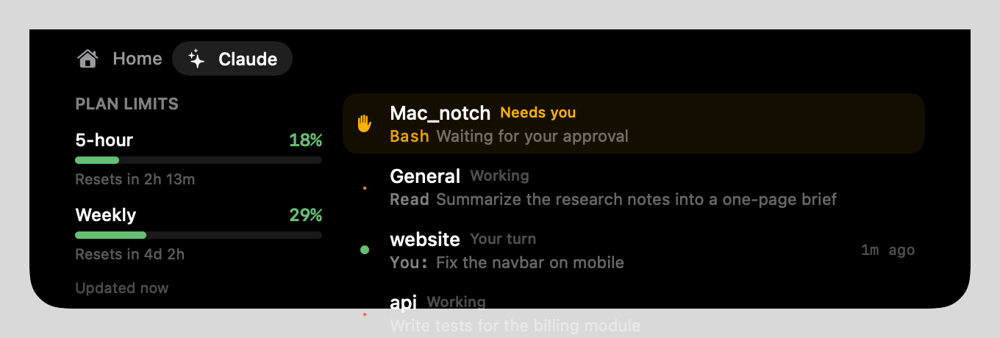
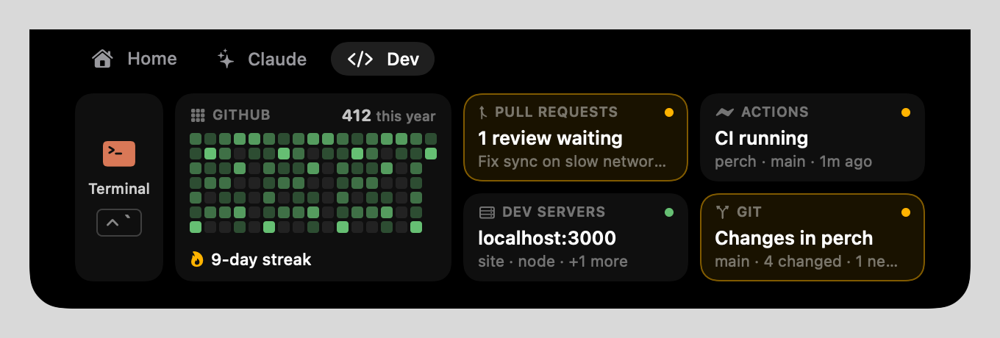
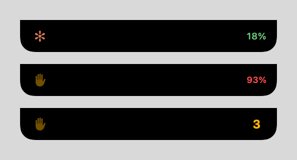
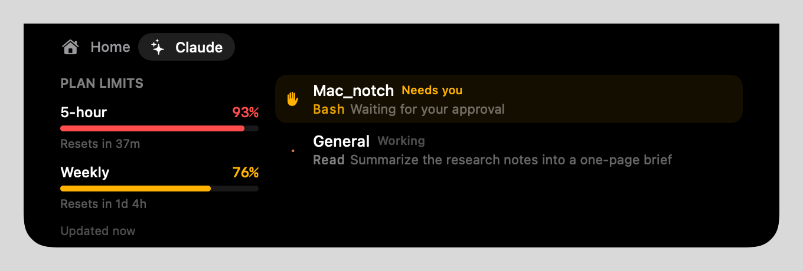
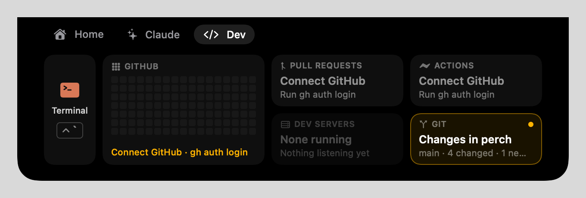

<div align="center">

# Perch

**Claude, perched in your MacBook's notch.**

Your Claude Code sessions and plan limits, a terminal that drops out of the notch,
and your whole dev setup at a glance: pull requests, Actions, dev servers and Git.




</div>

---

## Contents

- [What Perch does](#what-perch-does)
- [How it works](#how-it-works)
- [Install](#install)
- [Using Perch](#using-perch)
- [Security and privacy](#security-and-privacy)
- [Customize it](#customize-it)
- [Build from source](#build-from-source)
- [Troubleshooting](#troubleshooting)
- [Uninstall](#uninstall)
- [Credits and license](#credits-and-license)

---

## What Perch does

Perch is an independent notch app for macOS, built on [Boring Notch](https://github.com/TheBoredTeam/boring.notch).
It is not made by Anthropic or The Bored Team. Hover over the notch and you get three tabs:

- **Home**: music, calendar, battery and the webcam mirror, all from Boring Notch.
- **Claude**: your Claude Code sessions and plan limits.
- **Dev**: the terminal, GitHub, dev servers and your projects.

| | Feature | What you get |
|---|---|---|
| 📊 | **Plan limits** | Five-hour and weekly usage as bars that go green → amber → red, with "Resets in 2h 13m". |
| 🟠 | **Live sessions** | Every Claude Code session: *Working* (and the tool it's using), *Needs you*, or *Your turn*. |
| ✻ | **A notch that follows you** | The closed notch shows whatever you're *not* looking at: Claude while you watch something, what's playing while you're in Claude. |
| ✋ | **Needs-you alerts** | A pulsing amber hand on the closed notch when Claude is waiting for your approval. |
| ⌨️ | **Drop-down terminal** | Press **Control-`** anywhere and a terminal slides out of the notch. Press it again and it's gone, still running. |
| 🧑‍💻 | **Dev tab** | Your GitHub contribution graph, pull requests and reviews waiting on you, Actions runs, running dev servers, and the Git status of your recent projects. |
| ↗️ | **One click away** | Click a session to jump to it, a pull request or run to open it, a dev server to open `localhost`, a project to open the terminal there. |

It works with Claude Code in the **Claude desktop app's Code tab** and in **any terminal**.

<p align="center">
  
  <br>
  <sub>The Dev tab: everything at a glance. Amber outlines mark what needs you.</sub>
</p>

<p align="center">
  
  <br>
  <sub>The closed notch: Claude working, a session needs you, three need you, and one just finished.</sub>
</p>

---

## How it works

Perch is three small pieces that talk through a few files on your Mac:

```
 Claude Code ──── perch-bridge mod ────┐
                                       ▼
                        ~/Library/Application Support/Perch/
                          sessions/<id>.json   limits.json   dev.json
                                       ▲                        ▲
 git · lsof · gh ──── Perch Helper ────┘────────────────────────┘
                      └─ the drop-down terminal
                                       │
                                       ▼  reads the files
                              Perch.app (the notch)
```

| Piece | What it is | Why it's separate |
|---|---|---|
| **Perch.app** | The notch you see. | It runs in the macOS **App Sandbox**: it can read its own folder and nothing else. |
| **perch-bridge** | A Claude Code *mod*, a small plugin that runs inside Claude Code. | Only Claude Code knows what a session is doing and how much of your plan is used. |
| **Perch Helper** | A small companion app that ships inside Perch.app. | A terminal and tools like `git` can't work inside a sandbox, so this part runs outside it. |

None of the pieces call each other. Each writes or reads plain files in one folder.

---

## Install

### What you need

- A Mac with **macOS 14 Sonoma or later** (Apple silicon or Intel). Made for MacBooks with a notch;
  on other screens it shows as a small bar at the top centre.
- **Claude Code** 2.1.287 or later, or the **Claude desktop app** 2.1.286 or later.
- A Claude **Pro or Max** plan for plan limits. Sessions show on any plan.
- For the GitHub cards: the free [GitHub CLI](https://cli.github.com) (`brew install gh`).

### Step 1 · Install the app

1. Download **`Perch-1.2.0.zip`** from the [latest release](https://github.com/Krishu-24/perch/releases/latest).
2. Unzip it and drag **Perch.app** into **Applications**.
3. Open it. macOS will say it *can't check Perch for malicious software*, because the app isn't
   signed with a paid Apple Developer ID. To open it anyway:
   - open **System Settings → Privacy & Security**, scroll down, and click **Open Anyway** next to Perch, **or**
   - run this once in Terminal:
     ```bash
     xattr -dr com.apple.quarantine /Applications/Perch.app
     ```
4. Perch walks you through a short welcome. Hover over the notch to try it.

Perch Helper comes inside Perch.app and starts with it. There's nothing else to install for the
terminal or the Dev tab.

> [!TIP]
> Want it to start with your Mac? **Perch menu bar icon → Settings → General → Launch at login.**

> [!IMPORTANT]
> Only one notch app can use the notch at a time. Quit Boring Notch, NotchNook, Vibe Notch,
> Open Island and the like before you open Perch.

### Step 2 · Connect Claude Code

Install the `perch-bridge` mod once. Every Claude session you start afterwards uses it.

**In the Claude desktop app:** click **+** next to the prompt box → **Plugins** → **Add marketplace**,
enter `Krishu-24/perch`, then add **perch-bridge**.

**Or in a terminal**, at the `claude` prompt:

```
/plugin install perch-bridge --marketplace Krishu-24/perch
```

Answer `y` to add the marketplace and press Enter for the user scope.

### Step 3 · Connect GitHub (optional)

For pull requests, Actions and your contribution graph, sign in to the GitHub CLI once. Press
**Control-`** to drop the terminal down and run:

```bash
brew install gh     # if you don't have it yet
gh auth login       # choose GitHub.com, then sign in with your browser
```

Perch never sees your GitHub token: it asks `gh` for data, and `gh` keeps the token in your Keychain.

### Step 4 · Check it works

1. Start a **new** Claude session (ones already open don't load the mod) and send any message.
2. Hover over the notch and click **Claude**: your session appears, and once Claude replies,
   your plan limits fill in.
3. Click **Dev**: your project shows up with its Git status, and GitHub fills in within a few minutes.
4. Press **Control-`**: the terminal drops out of the notch.

---

## Using Perch

### The Claude tab



| Part | Meaning |
|---|---|
| **5-hour / Weekly bars** | How much of each plan window you've used. Green under 70%, amber under 90%, red from 90%. |
| **Resets in …** | When that window starts over. |
| **✋ amber row** | Claude is waiting for you to approve something. The tool's name is in amber. |
| **✻ spinner** | Claude is working. The tool it's running is in grey. |
| **🟢 dot** | Claude finished and it's your turn. The time on the right is how long ago. |
| **Click a row** | Brings the Claude app, or your terminal, to the front. |

Sessions appear after their first message. Finished sessions drop off after 30 minutes of quiet,
and a session that stops reporting (after a crash, say) is hidden after 2 hours.

### The closed notch

The closed notch shows **whatever you aren't looking at**: Claude or what's playing.

| You're in… | Something playing? | Claude is… | The closed notch shows |
|---|---|---|---|
| The app that's playing (Prime in Safari, say) | Yes | working, finished or needs you | **Claude** |
| Claude | Yes | working or finished | **What's playing** |
| Anything else | Yes | working | **What's playing** |
| Anything else | Yes | finished or needs you | **Claude** |
| Anything | No | working, finished or needs you | **Claude** |

| Mark | Meaning |
|---|---|
| **✻ turning spark** + five-hour % | A session is working. |
| **Pulsing ✋** + five-hour % | A session needs you. |
| **Pulsing ✋** + a number | That many sessions need you. |
| **✓ green check** + five-hour % | A session finished in the last 5 minutes. It clears when you open Claude. |

> [!NOTE]
> When a video plays full screen, macOS hides the notch area entirely, so nothing shows there
> until you leave full screen.

### The drop-down terminal

- **Control-`** anywhere shows it; **Control-`** again, or clicking anywhere else, hides it.
- It's your normal login shell (zsh or bash) with your usual setup, starting in your home folder.
- Hiding doesn't stop anything: a running command keeps going, and you come back to the same place.
- Typing `exit` closes it; the next Control-` starts a fresh shell.
- Click the **Git** card on the Dev tab to open the terminal right in the project with changes.

### The Dev tab



Everything fits in one view; there's nothing to scroll. Each card answers one question in a word or
two, and the whole card is the button.

| Card | It tells you | Click to |
|---|---|---|
| **Terminal** | — | Drop the terminal down (same as Control-`). |
| **GitHub** | Your contribution graph for the last 17 weeks, this year's total and your current streak. | — |
| **Pull requests** | *1 review waiting*, *Checks failing*, *2 open* or *All clear*, with the pull request it means underneath. | Open that pull request. |
| **Actions** | The run that matters most: a running one, else a failed one, else the latest. *CI running*, *CI failed*, *CI passed*. | Open that run. |
| **Dev servers** | The first server you started (`npm run dev`, `python -m http.server` …) and how many more are running. | Open `http://localhost:<port>`. |
| **Git** | *Changes in perch* when a project has uncommitted work, *perch ↑2 to push* when commits are waiting, else *All committed*. | Open the terminal in that project. |

**Reading the colours:** an **amber outline** means it needs you (a review, uncommitted changes);
a **red outline** means something broke (failing checks, a failed run). A dot alone is a status:
green healthy, amber in progress. A grey card has nothing to report.

Local cards refresh every 6 seconds; GitHub every 3 minutes.

### Settings → Claude

| Setting | Default | What it does |
|---|---|---|
| Show Claude activity on the closed notch | On | The spark, hand and check described above. |
| Open the notch when Claude needs you | Off | Pops the notch open on the Claude tab the moment a session starts waiting. |
| Status / Active sessions / Limits updated | — | Whether the mod has connected, and how fresh the data is. |
| Show Data Folder in Finder | — | Opens `~/Library/Application Support/Perch`. |

---

## Security and privacy

Perch was built to be safe to run all day next to your code. The full threat model is in
[SECURITY.md](SECURITY.md). In short:

### 🔒 The mod (`perch-bridge`)

- **Never touches the network.** It makes no requests of any kind.
- **Never sees your login.** It doesn't read your Claude token, Keychain, cookies or settings files.
  Plan limits come from the same numbers Claude Code already shows in `/usage`.
- **Reads exactly one environment variable,** `HOME`, to find your Library folder.
- **Writes only inside** `~/Library/Application Support/Perch/`.
- **Can't approve or block anything.** It only listens. Every hook passes the event on unchanged,
  and if the mod itself fails, Claude Code carries on as if it weren't there.
- **Small and checkable:** about 115 lines in
  [`claude-mod/perch-bridge/hooks/register.ts`](claude-mod/perch-bridge/hooks/register.ts).
  `claude plugin validate claude-mod/perch-bridge` lists every event it hooks and every call it makes.

### 🛡️ The app (`Perch.app`)

- **Runs in the macOS App Sandbox** with the hardened runtime. Its one file exception is
  read/write access to `~/Library/Application Support/Perch/`. It can't open the rest of your files,
  and it never runs `git`, `gh` or a shell itself.
- **One hardened-runtime check is relaxed:** library validation. The release is signed without a
  developer identity, so macOS can't match the bundled frameworks to the app and would refuse to
  launch it otherwise. [SECURITY.md](SECURITY.md) explains this and how to remove it.
- **No telemetry, no analytics, no accounts.**
- **Automatic updates are switched off,** so nothing can replace Perch behind your back.
- **Network use is all inherited from Boring Notch's music features:** album art, one animation file,
  lyrics *only if you turn lyrics on*, and `localhost` for YouTube Music.

### 🧰 The helper (`Perch Helper.app`)

The helper is the one piece **outside** the sandbox, because a terminal has to be able to see your files.
Here is everything it does:

| It runs | For | How often |
|---|---|---|
| Your login shell | The drop-down terminal | When you open it |
| `git status`, `git log -1`, `git remote get-url` | Projects card | Every 6 s, in up to 6 recent projects |
| `lsof` (listening ports and their folders) | Dev servers card | Every 6 s |
| `gh auth status`, `gh api graphql`, `gh run list` | GitHub cards | Every 3 min, only if `gh` is installed and signed in |

- **It doesn't make network requests itself.** Only `gh` talks to GitHub, with the token `gh` keeps.
- **It writes only** `dev.json` and `helper-state.json` (your recent project folders) in Perch's folder.
- **It reads** the mod's session files, just to learn which folders you work in.
- **Its links are locked down.** Perch talks to it through `perch-helper://` links. The only one that
  takes input, *open the terminal in a folder*, is refused unless that folder is already one of the
  projects on the Dev tab, so a web page or another app can't use it to run anything.
- **The global shortcut (Control-`) needs no special permission.** It uses macOS's hot key API, not
  Accessibility, and it sees only that one key combination.
- It quits when Perch quits.

### 📄 What's stored, and for how long

| File | Contents | Kept |
|---|---|---|
| `sessions/<id>.json` | Session ID, project folder, first 120 characters of your latest prompt, tool name, status, time. | Deleted after 24 hours. |
| `limits.json` | Five-hour and weekly usage and reset times. | Overwritten as it changes. |
| `dev.json` | Your recent projects' Git status, dev servers, and the GitHub data on the Dev tab. | Overwritten every few seconds. |
| `helper-state.json` | Up to 12 recent project folders, so they survive a restart. | Folders that no longer exist are dropped. |

These are plain text files, readable by any app running as you, just like Claude Code's own history
in `~/.claude`. Delete the folder at any time; it's recreated as needed.

### 🔑 macOS permissions

Perch only asks when you use the feature that needs it:

| Permission | Used for |
|---|---|
| Calendars and Reminders | The calendar on the Home tab. |
| Camera | The mirror on the Home tab. |
| Automation (Music, Spotify) | Music controls. |
| Accessibility | Replacing the volume and brightness pop-ups. |

The Claude features, the Dev tab and the terminal need **no** macOS permissions.

### ⚠️ Know before you install

- The release isn't **notarized** by Apple, so macOS can't vouch for it. That's why the first launch
  needs *Open Anyway*. If you'd rather not trust a downloaded build, [build it yourself](#build-from-source).
- Install the mod only from **this** repository (`Krishu-24/perch`), never from a copy.

---

## Customize it

### Project layout

```
perch/
├── boringNotch/
│   ├── Claude/                        ← the Claude tab and closed-notch status
│   │   ├── ClaudeView.swift           the tab: limits panel and session rows
│   │   ├── ClaudeLiveActivity.swift   the closed notch, and the rule for when it shows Claude
│   │   ├── ClaudeSettings.swift       Settings → Claude
│   │   ├── ClaudeSessionStore.swift   reads the mod's files; tracks the app you're in
│   │   ├── ClaudeUsage.swift          parses limits.json
│   │   ├── ClaudeFormatting.swift     "Resets in 2h 13m", "4m ago"
│   │   └── StatusIcons.swift, ProcessingSpinner.swift, TerminalColors.swift
│   ├── Dev/                           ← the Dev tab
│   │   ├── DevView.swift              the cards and the one-glance layout
│   │   ├── DevStore.swift             reads dev.json, starts the helper, opens links
│   │   └── DevSnapshot.swift          the dev.json format, shared with the helper
│   └── …                              Boring Notch (Home tab, music, HUDs, settings)
├── helper/                            ← Perch Helper, a Swift package
│   ├── Sources/PerchHelper/
│   │   ├── TerminalPanel.swift        the drop-down terminal
│   │   ├── Collector.swift            gathers Git, dev servers and GitHub data
│   │   ├── HotKey.swift               Control-`
│   │   ├── Shell.swift                runs git, lsof and gh safely
│   │   └── main.swift                 the app and its perch-helper:// links
│   ├── Sources/PerchDevCore/          parsing, kept free of AppKit so it's easy to test
│   └── Tests/                         unit tests for the parsing
├── claude-mod/perch-bridge/           the Claude Code mod
├── .claude-plugin/marketplace.json    lets Claude Code install the mod from this repo
├── scripts/
│   ├── build-release.sh               build Perch with the helper inside, and zip it
│   ├── claude-tests/run.sh            run every test
│   └── claude-tab-snapshots/render.sh render the Claude and Dev tabs to PNGs
└── docs/images/                       the screenshots in this README
```

### Common changes

| You want to… | Change |
|---|---|
| Change the colours | `TerminalColors` in `boringNotch/Claude/TerminalColors.swift`. |
| Use a different terminal shortcut | `HotKey(keyCode:modifiers:)` in `helper/Sources/PerchHelper/main.swift`. |
| Make the terminal bigger or smaller | `maxSize` in `helper/Sources/PerchHelper/TerminalPanel.swift`. |
| Keep the terminal open when you click elsewhere | Remove `windowDidResignKey` in `TerminalPanel.swift`. |
| Refresh GitHub more or less often | `githubInterval` in `helper/Sources/PerchHelper/Collector.swift`. |
| Show more projects | `projectLimit` in `Collector.swift`. |
| Change when the closed notch shows Claude | `ClaudeLiveActivity.shouldShow` in `ClaudeLiveActivity.swift`. |
| Add a card to the Dev tab | Add a `DevTile` in `DevView.swift`, and the data it needs to `DevSnapshot.swift` and `Collector.swift`. |
| Move the green/amber/red thresholds | `ClaudeLimitBar.tint(for:)` in `ClaudeView.swift`. |
| Send more (or less) from Claude Code | `register.ts`; add the new fields to `ClaudeSession` too. |

### Check your changes

```bash
# Every test: Claude and Dev logic, the helper's parsers, and the mod
scripts/claude-tests/run.sh

# Render the Claude and Dev tabs and the closed notch with sample data → build/claude-snapshots/*.png
scripts/claude-tab-snapshots/render.sh
```

The mod's tests need the Claude Code CLI. If `claude` isn't on your PATH, point `CLAUDE_CLI` at it:

```bash
CLAUDE_CLI="$HOME/Library/Application Support/Claude/claude-code/<version>/<build>/claude.app/Contents/MacOS/claude" scripts/claude-tests/run.sh
```

### Working on the mod

Install it from your own checkout so edits take effect without publishing anything:

```bash
claude plugin marketplace add /path/to/perch
claude plugin install perch-bridge@perch
```

Claude Code then reads the mod straight from your folder. After an edit, run `/reload-plugins`
in a session, or start a new one.

---

## Build from source

You need **Xcode 26** or later.

```bash
git clone https://github.com/Krishu-24/perch.git
cd perch
scripts/build-release.sh
open build/DerivedData/Build/Products/Release/Perch.app
```

The script builds Perch and Perch Helper, puts the helper inside Perch.app, signs both for your Mac
only (no Apple Developer account needed) and zips the result into `build/release/`.

To work in Xcode instead, open `boringNotch.xcodeproj`, choose **Sign to Run Locally**, and press ⌘R.
Build the helper with `helper/build.sh` and copy `Perch Helper.app` into Applications so the Dev tab
can find it.

---

## Troubleshooting

<details>
<summary><b>The Claude tab says "Claude isn't connected yet"</b></summary>

The mod hasn't written anything yet. Check that `perch-bridge` is installed (in a terminal:
`claude plugin list`), then start a **new** session and send a message. Sessions that were already
open when you installed it don't load it.
</details>

<details>
<summary><b>Sessions show, but the plan limits are empty</b></summary>

Limits arrive with Claude's first reply in a session, and only on a Pro or Max plan.
</details>

<details>
<summary><b>Control-` does nothing, or VS Code's terminal stopped toggling</b></summary>

Only one app can own a global shortcut. If another app took Control-` first, Perch's doesn't work;
if Perch has it, apps like VS Code no longer get it. Change it in `helper/Sources/PerchHelper/main.swift`
(see [Common changes](#common-changes)), or use the **Terminal** button on the Dev tab.
</details>

<details>
<summary><b>The Dev tab says Perch Helper isn't running</b></summary>

Click **Start Perch Helper**. If it keeps stopping, make sure you're running the Perch.app from the
release (it contains the helper), and that only one copy of Perch is installed.
</details>

<details>
<summary><b>The GitHub cards ask me to sign in</b></summary>

Run `gh auth login` in the drop-down terminal, then open the Dev tab again: while GitHub isn't
connected, opening the tab checks straight away. Otherwise it checks every 3 minutes.
</details>

<details>
<summary><b>A dev server I started doesn't show</b></summary>

Perch lists programs that listen on a port below 49152 and run from a folder in your home folder.
Something started from `/` or from inside an app, or on a random high port, is skipped on purpose.
</details>

<details>
<summary><b>A session still says "Needs you" after I approved</b></summary>

The status changes back to *Working* when the approved tool finishes, so a long command keeps the hand up
until it's done.
</details>

<details>
<summary><b>macOS won't open the app</b></summary>

See [Step 1](#step-1--install-the-app). Use *Open Anyway* or the `xattr` command once.
</details>

---

## Uninstall

1. Quit Perch (menu bar icon → Quit); the helper quits with it. Delete **Perch.app** from Applications.
2. Remove the mod: in a terminal, `claude plugin uninstall perch-bridge@perch`. In the desktop app,
   use **+ → Plugins**.
3. Delete its data: `rm -r ~/Library/Application\ Support/Perch`.
4. Optional, to remove its settings: `rm -r ~/Library/Containers/io.github.krishu-24.perch`.
5. Optional, to sign the GitHub CLI out: `gh auth logout`.

---

## Credits and license

Perch stands on other people's open-source work:

| Project | License | What Perch uses |
|---|---|---|
| [Boring Notch](https://github.com/TheBoredTeam/boring.notch) | GPL-3.0 | The whole notch app Perch is built on. |
| [SwiftTerm](https://github.com/migueldeicaza/SwiftTerm) | MIT | The terminal inside Perch Helper. |
| [Vibe Notch](https://github.com/farouqaldori/vibe-notch) | Apache-2.0 | Status icons, spinner, colours and the session row layout. |
| [Open Island](https://github.com/Octane0411/open-vibe-island) | GPL-3.0 | The usage-limits parser. |
| [CapaTheNotch](https://github.com/maximfakel/capa-the-notch) | MIT | Its research showed how to read limits outside the terminal. |

Every copied file says where it came from. Third-party notices are in
[THIRD_PARTY_LICENSES](THIRD_PARTY_LICENSES).

**Perch is licensed under the [GNU General Public License v3.0](LICENSE)**, the same as Boring Notch.
In plain words:

- ✅ Use it, study it, change it, and share it, for free, for any purpose.
- ✅ Share your own modified version with anyone.
- 📌 If you share a version, share its source code under GPL-3.0 too, and keep the credits.

**Modification notice:** Perch is a modified version of Boring Notch 2.7.3, changed starting
3 November 2026. [CHANGELOG.md](CHANGELOG.md) lists what was added, removed and changed, and the
git history shows every change in detail.

> [!NOTE]
> Perch is an independent project. It is not affiliated with, endorsed by or supported by
> Anthropic or The Bored Team. "Claude" and "Claude Code" are trademarks of Anthropic, and
> "Boring Notch" belongs to The Bored Team; they are used here only to say what Perch works with
> and where it comes from.
